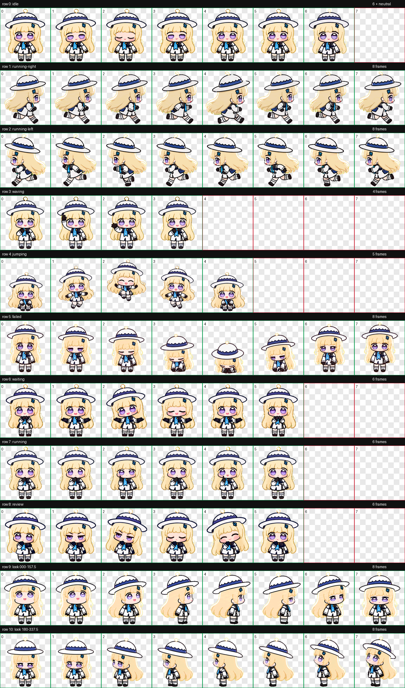

# Codex 宠物：菲比啾比

菲比啾比是一个 Codex 兼容的 v2 动画宠物。角色采用 Q 版风格：金色长发、紫色大眼、蓝白宽檐帽与蓝黑白制服。




## 文件

- `pet.json`：宠物清单。
- `spritesheet.png`：8 列 × 11 行透明动画精灵表，与本次云端更新的图像像素一致。
- `preview/contact-sheet.png`：动作总览。
- `preview/idle.gif`：按宿主待机时序播放的眨眼与微歪头预览。
- `preview/look-directions.png`：16 个观察方向预览。
- `qa/`：结构、方向语义及盲测验证结果。

## 动画

包含 idle、running-right、running-left、waving、jumping、failed、waiting、running、review，以及两行 16 方向观察动画。

- 待机：小幅呼吸、缓慢眨眼和极轻微歪头；眨眼前后有半睁眼过渡，首尾姿势一致。
- 指针悬停：蓄力小跳；宿主使用 `jumping` 行回应悬停。
- 问候：扶帽挥手。
- 等待输入或确认：期待回应的合手、摊手动作。
- 工作处理：原地托腮思考。
- 结果待查看：歪头检查。

待机六帧的宿主时长分别为 `1680、660、660、840、840、1920 ms`，每轮约 `6.6 秒`。只有第 3 帧闭眼，闭眼约 `0.66 秒`。这些时长由宿主控制，修改精灵图不会提高应用帧率。预览和图集已验证，应用内实际播放观感仍需手动确认。

## 安装

将本仓库复制到 Codex 宠物目录：

```text
%USERPROFILE%\.codex\pets\feibi-jiubi
```

目录中必须保留 `pet.json` 与 `spritesheet.png`。从旧版升级时，请同时替换清单和精灵图，再重新打开宠物。

如果该宠物已经迁移到云端，仅覆盖本地目录不会更新正在使用的云端图集；需要更新同一个云端宠物的精灵图。

## 验证

- `spriteVersionNumber`: `2`
- 精灵表：`1536 × 2288`、RGBA PNG
- 布局：`8 × 11`
- 透明背景残留：`0`
- 结构验证：通过
- 待机首尾像素：一致
- 16 方向姿态：轮廓与既有版本一致，保留既往方向语义及盲测记录；本次未重新运行盲测

部分斜向观察角度仅保留细微水平提示；已通过独立视觉复核。

## 许可

本仓库未声明开源许可。未经授权，不授予复制、修改或再分发权利。
